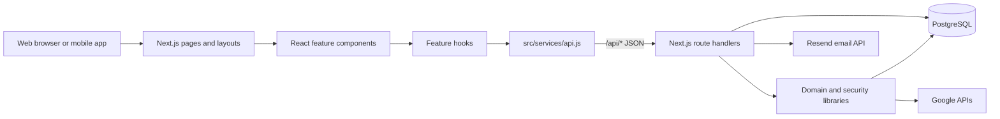
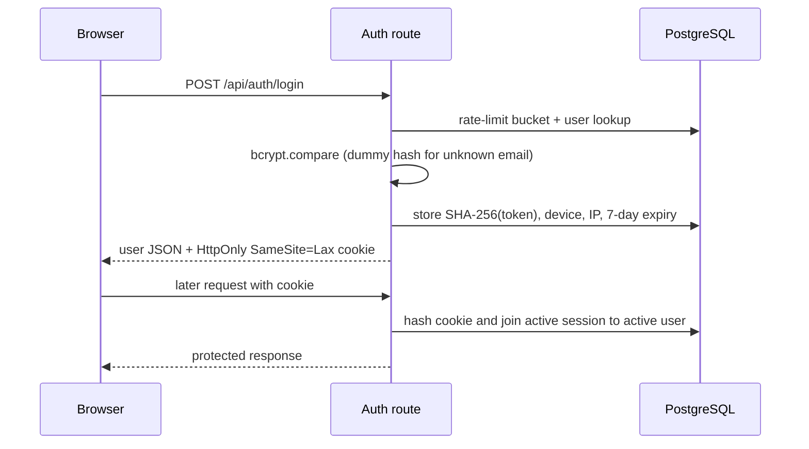
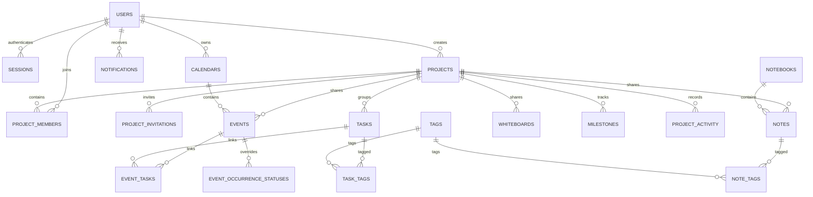

# Optimus Codebase Guide

This document explains the current Optimus working tree as of **2026-08-13**. It is intended to answer four questions:

1. What is this application?
2. Where does each kind of code live?
3. How does a user action travel through the system?
4. Why do both `database.sql` and many migration files exist?

The guide describes the code that is actually wired today, and separately labels historical or dormant schema. Start with [Architecture in one page](#architecture-in-one-page), then use the feature and API sections as a reference.

## 1. Executive summary

Optimus is a **single-repository, full-stack productivity application**. It combines a public marketing site and an authenticated workspace for tasks, projects, notes, calendars, whiteboards, saved links, study resources, routines, collaboration, notifications, and Google Calendar integration.

The important architectural facts are:

- It uses the **Next.js App Router**. Pages and HTTP API handlers live in the same `src/app` tree.
- Most authenticated screens are **client React components**, but authentication is checked first in a **server layout**.
- Client code calls a central wrapper in `src/services/api.js`; there is no separately deployed backend.
- API handlers use **raw, parameterized PostgreSQL queries** through `pg`; there is no ORM and no generated model layer.
- Web and mobile use the same database-backed session system. Web receives an `HttpOnly` cookie; mobile receives the opaque token and sends it as a bearer token.
- Personal data is owner-scoped. Project data is visible to project members, but edit/delete rules distinguish the item creator from the project creator.
- Calendar recurrence is expanded on read from master events. Task recurrence creates the next concrete task when the current task becomes done.
- Google synchronization is synchronous/direct. There is no current background worker or integration queue.
- Notifications are currently limited to project invitations and invitation acceptances. Broader activity remains in project history.
- `database.sql` is a fresh-database baseline. Ordered files in `migrations/` evolve both old and fresh databases to the final schema.

At the time of this review the repository contains roughly:

- 288 JavaScript/CSS source files and 47,450 source lines
- 73 `/api` route files plus 2 `/.well-known` route files
- 90 feature/UI component files
- 23 hooks and 56 library modules
- 22 active SQL migration files
- 10 Node test files and 1 Playwright specification file

## 2. Architecture in one page



The normal request path is:

```text
page -> component -> feature hook -> service method -> /api route
     -> withAuth -> validation/access check -> SQL transaction/query
     -> JSON response -> hook state -> React re-render
```

A representative task update is:

```mermaid
sequenceDiagram
    participant UI as TaskModal/Kanban
    participant Hook as useTaskMutations
    participant API as services/api.js
    participant Route as /api/tasks/[id]
    participant Access as projectAccess/tagAccess
    participant DB as PostgreSQL

    UI->>Hook: updateTask(id, changes)
    Hook->>API: taskService.update(...)
    API->>Route: PUT JSON + cookie/bearer token
    Route->>Route: withAuth resolves session
    Route->>Access: validate visibility and edit rights
    Route->>DB: BEGIN; lock task; update joins/status
    alt first transition to done and recurring
        Route->>DB: insert next occurrence idempotently
    end
    Route->>DB: record project activity when applicable; COMMIT
    Route-->>API: updated task JSON
    API->>API: clear 10-second read cache; emit data-changed event
    API-->>Hook: updated task
    Hook-->>UI: refetch/render
```

## 3. Technology stack

| Layer | Choice | Where it is visible |
|---|---|---|
| Framework | Next.js 16 App Router | `src/app`, `next.config.mjs` |
| UI | React 19 | client pages, components, contexts, hooks |
| Language | JavaScript ES modules | `package.json` has `"type": "module"`; there is a `jsconfig.json`, not a TypeScript app |
| Styling | Tailwind CSS 4, global utility/design classes, a few CSS modules | `src/app/globals.css`, `home.module.css`, auth/account CSS modules |
| Database | PostgreSQL via `pg` | `src/lib/db.js`, `database.sql`, `migrations/` |
| Authentication | bcrypt passwords + random opaque session tokens | `src/lib/auth.js`, `sessionTokens.js` |
| Rich notes | Tiptap | `src/components/notes/NoteEditor.js` |
| Whiteboards | Excalidraw | `src/components/whiteboards/WhiteboardCanvas.js` |
| Drag/drop | dnd-kit | task list and Kanban components |
| Calendar integration | Google OAuth and Calendar APIs | `src/lib/google*.js`, Google API routes |
| Email | Resend HTTP API | `src/lib/email.js` |
| Analytics | Vercel Analytics | root app layout |
| Testing | Node's test runner + Playwright | `tests/`, `e2e/` |
| CI | GitHub Actions + PostgreSQL 17 | `.github/workflows/ci.yml` |

There is no ORM, GraphQL layer, Redux store, message broker, cron service, file-storage SDK, or separate worker process in the current application.

## 4. Repository map

```text
optimus/
|-- src/
|   |-- app/                 Next.js pages, layouts, API routes, SEO routes
|   |-- components/          React UI grouped by feature
|   |-- hooks/               Client-side fetching and mutation state
|   |-- context/             Authentication and theme providers
|   |-- services/api.js      The browser's single JSON API client
|   |-- lib/                 Server/domain/security utilities and some shared UI logic
|   |-- proxy.js             Page redirect guard and request-ID propagation
|   `-- instrumentation.js   Structured logging for unhandled request errors
|-- public/avatars/          Built-in profile avatar SVGs
|-- database.sql             Fresh database baseline
|-- migrations/              Ordered, checksum-protected schema history
|-- scripts/                 Migration, verification, token, deployment, and E2E tools
|-- tests/                   Node tests and database integration test
|-- e2e/                     Browser critical-path tests
|-- .github/workflows/       CI definition
|-- package.json             Dependencies and developer commands
|-- next.config.mjs          Security headers and Next configuration
|-- .env.example             Configuration contract
|-- README.md                Setup/release operations summary
|-- PRODUCT_DESCRIPTION.md   Product-facing description
|-- FEATURES.md              Feature inventory
`-- appPlan.md               Earlier planning/design material; not the runtime source of truth
```

### Top-level documentation roles

- `README.md` is the concise setup, production, mobile auth, account deletion, notifications, and Google OAuth operations guide.
- `PRODUCT_DESCRIPTION.md` explains the product in customer/product language.
- `FEATURES.md` is a feature catalog.
- `appPlan.md` is planning context and can contain ideas that are broader than the current code.
- This file, `CODEBASE_GUIDE.md`, is the engineering map. When documents disagree, the current routes, libraries, and migrations are authoritative.

## 5. Next.js application structure

### Route groups and layouts

Parentheses in `src/app/(auth)` and `src/app/(dashboard)` are **route groups**. They organize files and attach layouts but do not appear in the URL.

- `src/app/layout.js` is the root server layout. It installs global CSS, the toast provider, Vercel Analytics, metadata, and an inline pre-hydration theme script.
- `src/app/(auth)/layout.js` checks the session on the server. An already signed-in user is redirected to `/dashboard`.
- `src/app/(dashboard)/layout.js` checks the session on the server. An unauthenticated user is redirected to `/login`, while an authenticated user is injected into `AuthProvider` and rendered in `DashboardShell`.
- `src/proxy.js` is a lightweight early page guard. It redirects protected page paths when no cookie exists and attaches an `x-request-id`. It only checks cookie presence; the server layout/API authentication performs the real database-backed validation. API paths are excluded from this proxy.

### User-facing pages

| URL | File | Purpose |
|---|---|---|
| `/` | `src/app/page.js` | public marketing page |
| `/contact` | `src/app/contact/page.js` | public Lancehawks contact page |
| `/login` | `src/app/(auth)/login/page.js` | sign in |
| `/signup` | `src/app/(auth)/signup/page.js` | account creation |
| `/forgot-password` | `src/app/(auth)/forgot-password/page.js` | request reset mail |
| `/reset-password` | `src/app/(auth)/reset-password/page.js` | consume reset token |
| `/account-deletion` | `src/app/account-deletion/page.js` | public policy plus authenticated deletion flow |
| `/mobile/oauth/google` | `src/app/mobile/oauth/google/page.js` | fixed mobile OAuth result/App Link destination |
| `/dashboard` | `src/app/(dashboard)/dashboard/page.js` | aggregated daily command center |
| `/tasks` | `src/app/(dashboard)/tasks/page.js` | task list, Kanban, filters, bulk actions |
| `/notes` | `src/app/(dashboard)/notes/page.js` | notebooks, rich notes, journals |
| `/calendar` | `src/app/(dashboard)/calendar/page.js` | month/week/day calendar, time blocking, Google sync |
| `/projects` | `src/app/(dashboard)/projects/page.js` | project cards and detailed collaboration view |
| `/whiteboards` | `src/app/(dashboard)/whiteboards/page.js` | Excalidraw boards and templates |
| `/bookmarks` | `src/app/(dashboard)/bookmarks/page.js` | saved links and collections |
| `/resources` | `src/app/(dashboard)/resources/page.js` | resources, reading list, flashcards |
| `/habits` | `src/app/(dashboard)/habits/page.js` | current Routines UI: checklist + day planner |
| `/settings` | `src/app/(dashboard)/settings/page.js` | profile, appearance, sessions, notifications, Google/account controls |

`robots.js` blocks authenticated paths and `/api/` from crawlers. `sitemap.js` exposes only public pages. The two `.well-known` route handlers generate iOS and Android app-association JSON at runtime.

### Dashboard shell

`src/components/layout/DashboardShell.js` owns the persistent workspace frame:

- responsive/collapsible sidebar
- quick-capture floating action and modal
- global command palette
- keyboard shortcuts: `Ctrl/Cmd+K` for search and `Ctrl/Cmd+Shift+K` for quick capture
- localStorage persistence for sidebar state

`Sidebar.js` also hosts the notification center/alert surfaces and navigation. `PageHeader.js` is the shared feature-page header. `AppTopbar.js` exists as a layout component but the current shell is centered on the sidebar.

## 6. Frontend organization and state flow

### Components

Components are grouped by domain rather than by technical layer:

- `components/tasks`: cards, filters, modal, list, Kanban
- `components/calendar`: header/sidebar, month/week/day grids, event modal/block/pill, calendar manager, time-block panel
- `components/notes`: notebook sidebar, note list/editor, journal, templates
- `components/projects`: card, detail panel, modal
- `components/whiteboards`: card, modal, canvas, templates
- `components/bookmarks`: card, collection sidebar, modal
- `components/resources`: resource, reading-list, deck/card study interfaces
- `components/checklist` and `components/day-plan`: the Routines feature
- `components/dashboard`: widgets, morning review, action launcher, quick capture
- `components/notifications`: center, history, invitation actions, alerts, preferences, display mapping
- `components/search` and `components/quick-capture`: cross-feature entry points
- `components/ui`: reusable controls such as button, modal, input, tabs, toast, loading/error/empty states, and load-more control

### Contexts

- `AuthContext.js` holds the current user and browser login/signup/logout behavior. The server layouts normally provide `initialUser`, so client code does not need an initial `/auth/me` round-trip.
- `ThemeContext.js` owns seven theme variants, synchronizes the `data-theme` document attribute, and persists the selection locally.
- There is intentionally no global domain-state store. Feature hooks and page-local state own domain data.

### API client and cache behavior

`src/services/api.js` is the only general browser API wrapper.

- It prefixes endpoints with `/api`.
- It sends JSON with `credentials: "include"`.
- Non-2xx JSON becomes an `Error` carrying `status` and response data.
- A non-auth API `401` emits `optimus-session-expired`; `AuthContext` clears local user state and redirects to login.
- GET responses are cached in memory for 10 seconds, up to 100 entries.
- Every successful non-GET request clears that cache and emits `optimus-data-changed`.
- The dashboard listens for that event and performs a throttled background refresh, which is why a quick-captured item can appear without a page reload.

### Fetching hooks

- `useApiResource` handles abortable single-resource loading, background refresh, loading, and error state.
- `useCursorResource` handles keyset-paginated lists, deduplicated append, and load-more state.
- `useCleanFilters` stabilizes query filters so hooks do not refetch because of object identity changes.
- Domain hooks (`useTasks`, `useNotes`, `useProjects`, `useWhiteboards`, `useBookmarks`, `useResources`, and others) adapt service responses into UI state and expose mutation helpers.
- Notifications have dedicated summary/history/alert/sound hooks because their visibility, read-state, and polling rules differ from ordinary list resources.

Most large lists use cursor pagination. Calendar reads instead require a bounded date range, and the server rejects ranges over 90 days.

## 7. Backend/API conventions

An API route normally looks like:

```js
export const POST = withAuth(async (request) => {
  // parse and validate
  // check ownership/membership
  // query or transaction
  return apiResponse({ ... });
});
```

The shared conventions are:

- `withAuth` resolves the current session, distinguishes database/auth dependency failure (`503`) from a missing/invalid session (`401`), and attaches `request.user`.
- `apiResponse`, `apiNoStoreResponse`, `apiError`, and `apiUnavailable` produce consistent JSON responses.
- `apiValidation.js` validates strings, enums, booleans, dates, integers, UUIDs, UUID arrays, and colors. This is hand-written runtime validation rather than a schema library.
- Queries use `$1`, `$2`, and so on. Dynamic SQL is limited to controlled clauses/field lists after validation.
- Multi-row changes and any write that must be atomic use `transaction()` from `db.js`.
- Domain-specific access helpers live in `projectAccess.js`, `resourceAccess.js`, `tagAccess.js`, and `notebookAccess.js`.
- The event API is more layered than other features: route -> collection/detail service -> repository/presenter/permission/status modules.
- Expected validation/access errors become 4xx JSON. Unexpected exceptions are logged and generally become a generic 500 without leaking internals.

### Database connection behavior

`src/lib/db.js` creates a `pg.Pool` using `DATABASE_URL`, with `POSTGRES_URL` as a deployment fallback. The default pool maximum is 5. `DATE` values are returned as raw `YYYY-MM-DD` strings to prevent timezone shifts during JSON serialization.

`databaseUrl.js` validates that the URL is PostgreSQL and normalizes `sslmode=require`, `prefer`, or `verify-ca` to certificate-verifying `verify-full`. There is no automatic localhost fallback when configuration is missing.

## 8. Authentication and account flows

### Web session flow



The raw session token is never stored in PostgreSQL. It is 48 random bytes encoded as base64url; only its SHA-256 hash is stored. Cookies are `Secure` in production and expire after seven days.

### Mobile session flow

Mobile explicitly sends `X-Optimus-Client: mobile` to login/signup and receives `{ user, token, expiresAt }`. It then sends `Authorization: Bearer <token>`. Bearer credentials take precedence over a cookie when both are present.

`POST /api/auth/refresh` is mobile-only and bearer-only. It locks the current session row and atomically replaces the token hash and expiry. The old token stops working immediately.

### Password reset and password change

- Forgot-password always avoids exposing whether an account exists. Reset tokens are hashed in `password_resets` and expire after one hour.
- `email.js` calls Resend directly. In development, missing email configuration does not expose a real delivery; in production it is an error.
- Changing a password requires the current password and exact current session. It updates the bcrypt hash and revokes every other session in the same transaction.

### Account deletion

Deletion requires the exact phrase `DELETE MY ACCOUNT` and the current password. `accountDeletion.js` then runs a single transaction:

1. Lock and reauthenticate the account.
2. Transfer each owned shared project to its longest-standing active remaining member.
3. Delete owned projects with no remaining active member.
4. Transfer the deleting user's project-linked tasks, notes, whiteboards, reading-list items, and events to the surviving project owner.
5. Move transferred events to a surviving owner's calendar and sever their old Google identity.
6. Delete sessions, OAuth flows, Google credentials, and finally the user row.

Foreign-key cascades remove the remaining private data. `project_activity.actor_user_id` becomes `NULL` so shared audit history survives without retaining the deleted profile.

### A naming trap: JWT

The current authentication path does **not** mint JWTs even though `jsonwebtoken` and `JWT_SECRET` still appear in dependency/configuration history. `JWT_SECRET` is only used by `manage-google-token-encryption.mjs` when explicitly migrating legacy Google tokens with `--allow-jwt-legacy`. New session credentials are opaque random tokens.

## 9. Authorization and collaboration model

There are no owner/editor/viewer roles in the final model. An abandoned role experiment was explicitly removed.

| Situation | Visible to | Editable by | Deletable by |
|---|---|---|---|
| Personal item (`project_id IS NULL`) | item creator | item creator | item creator |
| Project-linked task/note/event/whiteboard | all project members | item creator or project creator | project creator |
| Milestone | project members | milestone creator or project creator | project creator according to route checks |
| Project itself/membership | project members can read | project creator controls project/membership | project creator |

The owner is `projects.user_id`. Membership is a row in `project_members`; a database trigger ensures each project creator is also a member.

`projectScopedAccessCondition(alias)` is the core SQL visibility rule: personal rows must belong to the viewer, while project rows require a matching membership. The route then applies the stricter edit/delete rule.

Shared event responses deliberately hide the creator's private calendar ID and Google event/sync fields from other project members. They see project-derived calendar labeling/color instead.

Tags remain user-owned. A project owner editing someone else's shared item may retain/remove tags already on that item but cannot attach unrelated private tags owned by the collaborator.

## 10. Feature-by-feature flow

### Dashboard

The dashboard uses one aggregate endpoint, `/api/dashboard/overview`, instead of making a request per widget. The endpoint concurrently computes task/project metrics, bounded calendar events, and day-plan status. Client date boundaries and the IANA timezone are sent explicitly so “today” and weekly metrics match the browser.

Widgets render today's tasks, upcoming events, active projects, recent notes, weekly pulse, and morning review. Mutation events from anywhere in the open browser schedule a background overview refresh.

### Tasks

Core tables: `tasks`, `task_tags`, `task_dependencies`, `tags`.

- A subtask is another `tasks` row with `parent_task_id`.
- Statuses are `todo`, `in_progress`, `on_hold`, `done`; priorities are `low`, `medium`, `high`, `urgent`.
- The list/Kanban views share the same routes and dnd-kit reordering.
- Bulk complete, delete, status update, archive, and reorder are handled by `/api/tasks/bulk`.
- Dependencies must be visible to the viewer and, for a project task, in the same project.
- Completing a recurring task is transition-based: only the first change from non-done to done creates the next task. A row lock plus the unique `recurrence_source_task_id` index makes retries/concurrent completion idempotent.

### Projects and collaboration

Core tables: `projects`, `project_members`, `project_invitations`, `milestones`, `project_activity`, `notifications`.

- Project creation automatically creates owner membership through a database trigger.
- Adding a member by email creates or renews a pending invitation; it does not immediately grant membership.
- Accepting an invitation transactionally changes invitation status and inserts membership.
- Tasks, notes, events, whiteboards, and reading-list items become shared by assigning `project_id`.
- Activity is a persistent project-local audit feed. It is not the same thing as the notification center.
- Milestones carry `created_by` because collaboration requires creator-aware editing.

### Notes and journals

Core tables: `notebooks`, `notes`, `note_tags`, `tags`.

Tiptap stores note content as text containing editor HTML. The notes page owns selection, search, title save, content autosave, journal/template creation, and project/notebook assignment. Saves are serialized; pending title/content changes are flushed before switching/deleting and on page hide. This prevents a slower earlier save from overwriting a newer edit.

A journal is a normal note with `is_journal` and `journal_date`. A project-linked note follows the collaboration permission model; a notebook remains personal.

### Calendar and events

Core tables: `calendars`, `events`, `event_tasks`, `event_occurrence_statuses`.

- Events can be ordinary events, focus blocks, or time blocks.
- Event status can be scheduled, in progress, done, missed, or cancelled.
- Events can link to multiple accessible tasks through `event_tasks`.
- Calendar list reads are range-bounded to 90 days.
- Missed display status is derived on read; ordinary reads do not persist derived missed state.
- Recurring master rows are expanded in `recurrence.js` into virtual IDs such as `master-uuid___2026-08-13`.
- Per-occurrence status is stored separately, so marking one recurring occurrence done does not modify the whole series.
- App recurrence rules are converted to/from the supported subset of Google RRULEs.

### Google Calendar

Core tables: `google_connections`, `google_oauth_flows`, plus Google fields on `calendars` and `events`.

OAuth uses state + PKCE:

1. `/api/google/auth` creates a random opaque state, stores only its SHA-256 hash, encrypts the PKCE verifier, binds the flow to the current session, and expires it after 10 minutes.
2. Google redirects to `/api/google/callback`.
3. The callback atomically consumes the one-time flow before exchanging the code.
4. Access and refresh tokens are encrypted with AES-256-GCM under `TOKEN_ENCRYPTION_KEY`.
5. The server immediately imports calendars, pushes eligible pending local events, and imports Google events.

Web callbacks also require the signed-in cookie and return to `/calendar`. Mobile flows are identified by their opaque state prefix, do not require a callback cookie, and redirect only to the fixed configured HTTPS `/mobile/oauth/google` App/Universal Link. No token, user ID, code, or client-provided return URL is placed in the redirect.

Calendar page load performs one sync when connected; the user can also press Sync. Event create/update commits locally and then directly attempts the Google upsert, returning a sync outcome. Event deletion tries Google first and does not delete locally when that remote deletion fails. Read-only Google calendars are imported but excluded from local push operations.

The final migrations removed the earlier integration queue; there is no cron/worker to retry Google operations in the background.

### Whiteboards

Core table: `whiteboards`.

Excalidraw is dynamically imported in the browser. Board JSON is limited to about 2 MB. Saves carry `content_version`; the server locks the row and returns `409` if another tab saved a newer version. The browser serializes saves and keeps the latest draft in IndexedDB (`optimus-local-drafts`) until the server accepts it. This combines optimistic concurrency with local crash/reload recovery.

### Bookmarks

Core tables: `bookmark_collections`, `bookmarks`, `bookmark_tags`.

Bookmarks and nested collections are personal. On create/update the server can fetch page title/Open Graph metadata, but `safeRemoteMetadata.js` defends that server-side request against SSRF: only HTTP(S), standard ports, public DNS/IP addresses, limited redirects, HTML, identity encoding, a 5-second timeout, and a 512 KB response are accepted.

### Resources, reading list, and flashcards

Core tables: `resources`, `reading_list`, `flashcard_decks`, `flashcards`.

- Resources store metadata and a `file_url`; this repository does not implement binary upload/storage.
- Reading-list items can link to a resource and optionally a project.
- Flashcards are grouped by owner-scoped deck and use ease factor, interval, next review, last review, and review count fields for spaced-repetition updates.

### Routines: checklist and day plan

The `/habits` page currently combines two newer systems:

- `checklist_sections`, `checklist_items`, and `checklist_logs` implement daily repeatable checks and history.
- `day_plan_blocks` are reusable time-of-day templates; `day_plan_logs` record whether a day's proposal was accepted, edited, or rejected.

Applying a day plan uses an advisory transaction lock and deterministic `source_key` values. It idempotently upserts the selected blocks as calendar `time_block` events and removes obsolete blocks for that date.

The older `habits`/`habit_logs` tables are still queried by legacy dashboard indicator/stat endpoints but have no current CRUD API. See [Dormant and historical schema](#dormant-and-historical-schema).

### Global search and quick capture

The command palette debounces `/api/search` and searches tasks, notes, projects, bookmarks, and resources in parallel. PostgreSQL trigram indexes support the `ILIKE` search paths. Results contain internal navigation URLs, not raw database records.

Quick capture parses lightweight task syntax in the client, can create tasks or notes, and can optionally attach them to an accessible project. It uses the same task/note services as the full feature pages.

### Notifications

Current notification types are only:

- `project_invitation`
- `project_invitation_accepted`

Project edits still write `project_activity`, but ordinary activity does not create notification-center entries. In development there is no periodic poll. In a deployed build the summary refreshes every 10 minutes while visible, and it also refreshes on initial load, tab visibility, and panel interaction. Sound is generated in the open web page; there is no push provider or device registration.

## 11. Database model

### Relationship overview



### Active table groups

| Group | Tables | Meaning |
|---|---|---|
| Identity | `users`, `sessions`, `password_resets`, `rate_limit_buckets` | accounts, hashed credentials, password recovery, shared rate limits |
| Google | `google_connections`, `google_oauth_flows` | encrypted long-lived connection and one-time OAuth attempts |
| Projects | `projects`, `project_members`, `project_invitations`, `milestones`, `project_activity`, `notifications` | collaboration and audit/attention |
| Tasks | `tasks`, `tags`, `task_tags`, `task_dependencies` | execution, recurrence, nesting, tags, blockers |
| Calendar | `calendars`, `events`, `event_tasks`, `event_occurrence_statuses` | schedules, linked tasks, recurring-instance status |
| Notes | `notebooks`, `notes`, `note_tags` | knowledge and journals |
| Whiteboards | `whiteboards` | Excalidraw JSON, optimistic version, project link |
| Bookmarks | `bookmark_collections`, `bookmarks`, `bookmark_tags` | saved links and organization |
| Learning | `resources`, `reading_list`, `flashcard_decks`, `flashcards` | resource metadata, reading progress, spaced repetition |
| Routines | `checklist_sections`, `checklist_items`, `checklist_logs`, `day_plan_blocks`, `day_plan_logs` | repeatable daily actions and calendar planning |

Most owned records cascade when a user is deleted. Project links usually use `ON DELETE SET NULL` so deletion of a project does not accidentally delete every item unless the route/account-deletion semantics explicitly do so. Join tables normally cascade with either side.

### Dormant and historical schema

The baseline also creates tables that have no current route/component workflow:

- `reminders`
- `contacts`, `contact_interactions`, `contact_projects`
- `goals`, `key_results`, `goal_tasks`, `goal_projects`
- `api_keys`
- `user_settings` (current theme/notification settings are stored elsewhere)
- `ai_chats`, `ai_messages`

`habits` and `habit_logs` are partially dormant: dashboard stats still read them, but the current Routines screen writes checklist/day-plan tables and there is no habit CRUD route.

These tables remain because `database.sql` grew from a broader product plan and migrations prioritize safe, convergent upgrades over casually dropping user data. Their presence does **not** mean those features are currently reachable.

Historical migrations also created these tables and later removed them:

- `integration_jobs`, `job_checkpoints`, `integration_job_locks`
- `push_devices`, `push_notification_deliveries`

## 12. Why migration files exist

`database.sql` and `migrations/` solve different problems:

- `database.sql` answers: “How do I create the large base schema on a brand-new database?”
- A migration answers: “How do I safely move a database that already contains users/data from one released version to the next?”

Editing only `database.sql` cannot update a running production database. Re-running the whole baseline is unsafe because many statements are not intended to rebuild populated tables. Conversely, replaying migrations without a baseline would force a new install to reconstruct years of history. Optimus therefore uses both.

### What `npm run db:migrate` does

`scripts/migrate.mjs`:

1. Requires `DATABASE_URL` and opens a one-connection pool.
2. Takes a PostgreSQL advisory lock so only one migrator runs at once.
3. Creates `schema_migrations(name, checksum, applied_at)` if necessary.
4. If there is no `users` table, applies all of `database.sql` in one transaction and records a synthetic baseline migration.
5. Sorts every `migrations/*.sql` file lexicographically, which is why filenames begin with `YYYYMMDD`.
6. Computes a normalized SHA-256 checksum for every SQL file.
7. Skips a migration already recorded with the same checksum.
8. Refuses to continue if an applied file changed, an unknown applied migration exists, or a retired migration's checksum does not match.
9. Strips only standalone historical `BEGIN`/`COMMIT` markers, then wraps each migration and its ledger insert in one transaction.

The practical rules are:

- Never edit an applied migration.
- Add a new later-dated migration for any schema/data change.
- Keep the fresh baseline compatible with the final migrated result.
- Run both `db:migrate` and `db:verify` after a change.
- Only add a missing historical filename to `retired.json` after deliberate review and with its exact checksum.

### Migration history

| Migration | Why it was added / final effect |
|---|---|
| `20260617_project_collaboration_mvp.sql` | adds project membership, backfills owners, adds event project links, and installs owner-membership trigger |
| `20260618_project_activity_notifications.sql` | adds project activity and per-user notification tables |
| `20260618_project_invitations.sql` | adds pending/accepted/declined collaboration invitations |
| `20260627_notification_live_sync_dedupe.sql` | deduplicates the then-current live notification mechanism; mostly historical after later notification narrowing |
| `20260628_calendar_time_blocking_status_colors.sql` | adds event color, status, and type fields/indexes |
| `20260628_project_invitation_notifications.sql` | represents invitations as persistent notification rows |
| `20260629_event_occurrence_statuses.sql` | adds per-date status overrides for recurring events |
| `20260630_event_completion_notifications.sql` | adds dedupe for a completion-check notification type later removed |
| `20260718_production_hardening.sql` | hashes sessions/reset tokens, adds DB rate limits, default-calendar uniqueness, source keys, and production indexes |
| `20260718_query_indexes.sql` | adds cursor/dashboard query access paths |
| `20260718_reliable_jobs.sql` | historically adds durable integration/notification job tables |
| `20260720_remove_project_access_roles.sql` | removes the abandoned owner/editor/viewer role columns and restores creator/member semantics |
| `20260721_project_item_creators.sql` | adds milestone `created_by` for creator-aware permissions |
| `20260722_release_hardening.sql` | adds idempotent task recurrence, whiteboard versions, missing legacy habit tables, trigram search, and list indexes |
| `20260726_account_deletion.sql` | makes project activity actor nullable with `ON DELETE SET NULL` |
| `20260726_expo_push_delivery.sql` | historically adds Expo device and delivery tables |
| `20260726_mobile_google_oauth.sql` | adds session-bound, hashed-state, encrypted-verifier OAuth flow records |
| `20260726_notification_cursor_pagination.sql` | adds deterministic notification keyset indexes |
| `20260726_push_device_session_scope.sql` | historically binds push devices to exact sessions and discards unverifiable legacy registrations |
| `20260731_in_app_notifications_only.sql` | deletes scheduled alert rows/preferences and removes push tables |
| `20260804_invitation_notifications_only.sql` | deletes all notification types except invitations/acceptances and narrows preferences |
| `20260805_remove_integration_job_queue.sql` | drops integration queue/checkpoint/lock tables because Google sync is now direct |

`retired.json` records `20260720_project_roles_and_task_recurrence.sql`, an applied historical experiment no longer present as an active SQL file. Its role changes were reversed; its task recurrence requirement is preserved by release hardening.

### Schema verification tools

- `db:verify-baseline` creates a temporary schema, applies the baseline and every migration, checks that a substantial schema exists, then rolls the whole operation back.
- `db:verify` checks migration checksums/pending files, required tables, removed role columns, account-deletion foreign keys, hashed credentials, encrypted OAuth state, duplicate calendars, and orphaned records. `VERIFY_DATABASE_URL` allows checking a restored backup instead of the primary database.
- `test:db` performs destructive fixture writes only when `ALLOW_DATABASE_TESTS=true`; the isolated E2E wrapper supplies a disposable schema.

## 13. Complete API surface

Unless marked public/special, every route below uses `withAuth`. Dynamic segments such as `[id]` are UUIDs validated by the relevant route.

### Authentication, operations, and Google

| Methods | Route | Responsibility |
|---|---|---|
| POST | `/api/auth/signup` | create user/session; cookie for web or token for explicit mobile |
| POST | `/api/auth/login` | authenticate and create session |
| POST | `/api/auth/logout` | delete current session and expire cookie |
| GET | `/api/auth/me` | current user |
| PUT | `/api/auth/profile` | profile/avatar/timezone/password changes |
| DELETE | `/api/auth/account` | permanent password-confirmed deletion |
| POST | `/api/auth/forgot-password` | create reset and send mail |
| POST | `/api/auth/reset-password` | consume reset and revoke sessions |
| POST | `/api/auth/refresh` | explicit mobile bearer-token rotation |
| GET | `/api/auth/sessions` | list current user's devices/sessions |
| DELETE | `/api/auth/sessions/[id]` | revoke one owned session |
| GET | `/api/health` | public readiness checks and release ID |
| GET | `/api/google/auth` | create web/mobile PKCE authorization URL |
| GET | `/api/google/callback` | public Google redirect; consumes protected state |
| GET | `/api/google/status` | connection and synchronized calendar status |
| POST | `/api/google/sync` | direct push/import reconciliation |
| POST | `/api/google/disconnect` | remove connection and Google calendar data linkage |
| GET | `/.well-known/apple-app-site-association` | runtime iOS Universal Link association |
| GET | `/.well-known/assetlinks.json` | runtime Android App Link association |

### Work, knowledge, and planning

| Methods | Route | Responsibility |
|---|---|---|
| GET, POST | `/api/tasks` | filtered/cursor list and create |
| GET, PUT, DELETE | `/api/tasks/[id]` | detail/update/delete |
| POST | `/api/tasks/bulk` | complete/delete/status/archive/reorder |
| POST, PUT, DELETE | `/api/tasks/[id]/subtasks` | child-task operations |
| GET, PUT | `/api/tasks/[id]/dependencies` | blocker links |
| GET, POST | `/api/tags` | user tags |
| GET, POST | `/api/notes` | filtered/cursor list and create |
| GET, PUT, DELETE | `/api/notes/[id]` | detail/update/delete |
| GET, POST | `/api/notebooks` | list/create notebooks |
| PUT, DELETE | `/api/notebooks/[id]` | update/delete notebook |
| GET, POST | `/api/calendars` | list/create calendars |
| GET, PUT, DELETE | `/api/calendars/[id]` | calendar detail/update/delete |
| GET, POST | `/api/events` | bounded range list and create |
| GET, PUT, DELETE | `/api/events/[id]` | event/master/occurrence operations |
| GET, POST | `/api/whiteboards` | filtered/cursor list and create |
| GET, PUT, DELETE | `/api/whiteboards/[id]` | board detail/versioned update/delete |
| POST | `/api/whiteboards/[id]/duplicate` | clone accessible board |
| GET, POST | `/api/bookmarks` | filtered/cursor list and create |
| GET, PUT, DELETE | `/api/bookmarks/[id]` | bookmark detail/update/delete |
| GET, POST | `/api/bookmark-collections` | list/create collections |
| PUT, DELETE | `/api/bookmark-collections/[id]` | update/delete collection |
| GET, POST | `/api/resources` | filtered/cursor list and create metadata |
| GET, PUT, DELETE | `/api/resources/[id]` | resource detail/update/delete |
| GET, POST | `/api/reading-list` | list/create reading items |
| PUT, DELETE | `/api/reading-list/[id]` | update/delete reading item |

### Projects, dashboard, learning, routines, and attention

| Methods | Route | Responsibility |
|---|---|---|
| GET, POST | `/api/projects` | accessible/cursor list and create |
| GET, PUT, DELETE | `/api/projects/[id]` | detailed project/update/delete |
| GET, POST | `/api/projects/[id]/members` | list/invite members |
| DELETE | `/api/projects/[id]/members/[userId]` | remove member |
| PATCH | `/api/project-invitations/[id]` | accept/decline invitation |
| GET | `/api/projects/[id]/activity` | project audit feed |
| GET, POST | `/api/projects/[id]/milestones` | list/create milestones |
| PUT, DELETE | `/api/projects/[id]/milestones/[milestoneId]` | update/delete milestone |
| GET | `/api/dashboard/overview` | aggregate current dashboard |
| GET | `/api/dashboard/stats` | legacy/general counts |
| GET | `/api/dashboard/indicators` | sidebar/routine indicators |
| GET | `/api/search` | cross-domain global search |
| GET, POST | `/api/flashcard-decks` | deck list/create |
| GET, PUT, DELETE | `/api/flashcard-decks/[id]` | deck detail/update/delete |
| GET, POST | `/api/flashcard-decks/[id]/cards` | card list/create |
| PUT, DELETE | `/api/flashcard-decks/[id]/cards/[cardId]` | card update/delete |
| POST | `/api/flashcard-decks/[id]/review` | spaced-repetition result |
| GET, POST | `/api/checklist/sections` | today's checklist structure/create |
| PUT, DELETE | `/api/checklist/sections/[id]` | update/delete section |
| POST | `/api/checklist/sections/[id]/items` | add item |
| PUT, DELETE | `/api/checklist/items/[id]` | update/delete item |
| POST | `/api/checklist/log` | toggle one day's completion |
| GET | `/api/checklist/history` | date-range completion history |
| GET, POST | `/api/day-plan/blocks` | reusable block list/create |
| PUT, DELETE | `/api/day-plan/blocks/[id]` | block update/delete |
| POST | `/api/day-plan/blocks/reorder` | reorder blocks |
| GET | `/api/day-plan/status` | one date's accept/edit/reject status |
| POST | `/api/day-plan/apply` | apply block set to calendar idempotently |
| GET, PATCH | `/api/notifications` | cursor history/summary and mark-many-read |
| PATCH | `/api/notifications/[id]` | mark one read |
| GET, PUT | `/api/notifications/preferences` | sound/read-on-view preferences |

## 14. Important library map

### Infrastructure and security

- `db.js`, `databaseUrl.js`: pool, transaction helper, TLS-safe URL resolution
- `apiUtils.js`, `apiValidation.js`: auth wrapper, JSON responses, request validation
- `auth.js`, `authRequest.js`, `sessionTokens.js`, `mobileSession.js`: web/mobile session lifecycle
- `rateLimit.js`: PostgreSQL-backed distributed rate-limit buckets
- `secretEncryption.js`: AES-256-GCM envelope for Google secrets
- `email.js`: password-reset delivery
- `logger.js`, `instrumentation.js`: structured JSON request/error logging
- `safeRemoteMetadata.js`: SSRF-resistant bookmark metadata retrieval
- `cursorPagination.js`, `notificationCursor.js`: opaque keyset cursor encoding/validation

### Access and collaboration

- `projectAccess.js`: membership, invitations, owner/item permission SQL
- `projectActivity.js`, `collaborationActivity.js`: activity recording/listing facade
- `resourceAccess.js`: project/resource/bookmark-collection ownership checks
- `tagAccess.js`, `notebookAccess.js`: private tag/notebook boundaries
- `projectValidation.js`: project payload rules
- `accountDeletion.js`, `accountDeletionValidation.js`, `passwordChange.js`: destructive account/security workflows
- `notifications/*`, `notificationPreferences.js`, `notificationPreferenceStore.js`: current invitation notifications and user preferences

### Calendar and Google

- `events/eventCollectionService.js`, `eventDetailService.js`: route-level use cases
- `events/eventRepository.js`: event/task/calendar SQL
- `events/eventPresenter.js`: viewer-safe response shape
- `events/eventPermissions.js`, `eventSecurity.js`: creator/member rules and redaction
- `events/eventStatusService.js`, `eventOccurrenceStatus.js`: recurring occurrence status
- `events/googleEventSyncService.js`: failure-wrapped direct Google operations
- `eventServerUtils.js`, `eventDisplay.js`, `calendarUtils.js`: validation and UI calculation
- `recurrence.js`, `rruleConverter.js`: virtual recurrence expansion and Google RRULE conversion
- `google.js`, `googleSync.js`: OAuth client and two-way calendar mapping
- `googleOAuthPrimitives.js`, `googleOAuthFlow.js`, `googleOAuthCompletion.js`: secure OAuth state/PKCE lifecycle
- `mobileAppLinks.js`: validated Apple/Android association documents

### Other domain logic

- `taskRecurrence.js`: idempotent next-task creation
- `quickCaptureParser.js`: lightweight capture syntax
- `whiteboardDraftStore.js`: browser IndexedDB draft persistence
- `avatarOptions.js`, `notificationPreferences.js`: controlled option sets
- `utils.js`: dates, class-name joining, and general UI helpers

## 15. Configuration

Use `.env.example` as the contract; put real values in `.env.local` or the hosting provider's secret manager.

| Variable | Required when | Purpose |
|---|---|---|
| `DATABASE_URL` | always | primary PostgreSQL connection |
| `POSTGRES_URL` | optional alternative at runtime | Vercel-style fallback used by app runtime, not by every script |
| `DATABASE_SSL=require` | provider requires TLS | forces certificate-verifying TLS normalization |
| `DB_POOL_MAX` | optional | pool size, default 5 |
| `TOKEN_ENCRYPTION_KEY` | production/Google | independent 32-byte AES key, hex or base64 |
| `JWT_SECRET` | legacy token conversion only | allows explicitly requested legacy Google-token decrypt path |
| `NEXT_PUBLIC_SITE_URL` | production and reset/OAuth links | canonical public origin |
| `RESEND_API_KEY`, `EMAIL_FROM` | password-reset delivery | Resend credentials/from identity |
| `GOOGLE_CLIENT_ID`, `GOOGLE_CLIENT_SECRET`, `GOOGLE_REDIRECT_URI` | Google integration | OAuth client configuration |
| `MOBILE_GOOGLE_OAUTH_RETURN_URL` | mobile Google flow | exact HTTPS URL ending `/mobile/oauth/google` |
| `MOBILE_APPLE_TEAM_ID`, `MOBILE_IOS_BUNDLE_ID` | iOS App Link | Apple association identity |
| `MOBILE_ANDROID_PACKAGE_NAME`, `MOBILE_ANDROID_SHA256_FINGERPRINTS` | Android App Link | Android association identity/certificates |
| `VERIFY_DATABASE_URL` | restored-backup verification | override `db:verify` target |
| `PRODUCTION_URL`, `EXPECTED_RELEASE` | deployment verification | deployed origin and optional expected commit |
| `E2E_BASE_URL`, `ALLOW_DATABASE_TESTS` | test tooling | browser target and explicit fixture-write safety gate |

Production `/api/health` requires database access, email, encryption key, encrypted Google rows/OAuth flows, public URL, fixed mobile return origin, and valid iOS/Android association configuration. Development readiness only requires the database check.

`next.config.mjs` applies CSP, frame denial, MIME sniffing protection, strict referrer/permissions policy, and production HSTS to all paths.

## 16. Developer commands and verification

| Command | What it does |
|---|---|
| `npm install` / `npm ci` | install dependencies |
| `npm run dev` | Next development server |
| `npm run build` | production build |
| `npm start` | serve built application |
| `npm run lint` | ESLint with Next configuration |
| `npm test` | Node tests in `tests/*.test.cjs` |
| `npm run test:db` | real PostgreSQL concurrency/index integration test; requires explicit safety flag |
| `npm run test:e2e` | Playwright critical paths against a production server |
| `npm run test:e2e:isolated` | build a disposable PostgreSQL schema, run DB + E2E tests, then drop only that validated schema |
| `npm run db:migrate` | apply baseline/migrations with ledger/checksums |
| `npm run db:verify` | verify applied schema and data invariants |
| `npm run db:verify-baseline` | test baseline + all migrations in a rolled-back temporary schema |
| `npm run tokens:verify` | inspect whether Google tokens use the current key/format |
| `npm run tokens:encrypt` | rewrite Google tokens under `TOKEN_ENCRYPTION_KEY` after backup |
| `npm run prod:verify` | smoke-check deployed readiness/security/routes |
| `npm run verify` | lint, Node tests, build, production dependency audit |

### Test coverage shape

The Node tests focus heavily on contracts and hardening:

- mobile bearer/cookie behavior and atomic refresh
- secure Google state/PKCE/App Links
- account deletion and password-session behavior
- project item and event permissions/redaction
- notification narrowing and cursor pagination
- migration checksum stability, URL TLS, SSRF defense
- direct Google sync, no worker/cron, aggregate reads
- idempotent task recurrence, serialized note saves, versioned whiteboards

`tests/database-integration.mjs` proves concurrent recurring-task completion creates only one next task and concurrent whiteboard saves reject one stale writer. Playwright covers quick-capture dashboard refresh, retryable dashboard failure UI, and opening the Excalidraw editor.

CI starts PostgreSQL 17 and runs migration, DB verification, lint, Node tests, DB integration, build, dependency audit, and Playwright on Node 22.

## 17. Reliability and security decisions worth preserving

- **Parameterize SQL.** Access helpers often inject only fixed SQL fragments; user values still belong in parameters.
- **Keep authorization in the query/transaction.** Client visibility and the page proxy are not security boundaries.
- **Use row/advisory locks for idempotency.** Recurring completion, day-plan application, account transfer, OAuth consumption, and migration execution rely on them.
- **Do not store raw session/reset/state tokens.** Hash them; encrypt secrets that must be recoverable.
- **Do not weaken the mobile OAuth return URL.** It is fixed to a verified HTTPS origin/path specifically to prevent credential leakage/open redirects.
- **Preserve shared-data deletion semantics.** A simple user cascade would destroy collaborators' work.
- **Keep event presenter redaction.** Project visibility must not leak a collaborator's private calendar/Google identifiers.
- **Keep list queries bounded.** Cursor pagination and the 90-day calendar maximum protect production memory/query cost.
- **Do not remove IndexedDB drafts or `content_version` independently.** They address different whiteboard failure modes.
- **Do not mutate old migrations.** Checksums deliberately make that a deployment failure.

## 18. Known confusing or stale areas

These are useful context for a new maintainer:

1. **Baseline is broader than the live product.** CRM, goals, AI chat, API key, reminder, and settings tables exist without routes. Treat route/component usage as the feature truth.
2. **“Habits” is now a Routines page.** Its active UI is checklist + day plan, while older habit tables remain and are still read by some aggregate endpoints.
3. **Notifications were deliberately narrowed.** Old migrations mention reminder/completion/push notifications because they document history; later migrations delete/retire them.
4. **Google jobs were deliberately removed.** The current sync is direct. Do not look for a worker that no longer exists.
5. **`jsonwebtoken`/`JWT_SECRET` are historical.** Current sessions are opaque, database-backed tokens.
6. **`appPlan.md` is not guaranteed current.** It represents product planning, not deployed wiring.
7. **`scripts/verify-deployment.mjs` still probes `/api/jobs/integrations`.** That route is absent after the integration queue was removed, so the current deployment verifier will fail with 404 until the stale probe is updated. This is a real inconsistency between the script and the final architecture.
8. **Resources are metadata, not uploaded binaries.** `file_url` is stored, but this repository has no storage-provider upload/delete implementation.
9. **The working tree may contain local changes.** Before editing, use `git status` and preserve unrelated changes; do not assume every difference belongs to the task at hand.

## 19. How to trace or change a feature

For an existing feature, follow this order:

1. Open its page under `src/app/(dashboard)`.
2. Follow imported components under `src/components/<feature>`.
3. Follow the feature hook under `src/hooks`.
4. Find its service object in `src/services/api.js` to learn the endpoint contract.
5. Open the corresponding `src/app/api/.../route.js`.
6. Follow imported access/domain libraries in `src/lib`.
7. Locate every SQL table/column in `database.sql` and later migrations.
8. Search `tests/` for the route, helper, table, or behavior before changing it.

For a new persisted feature/change:

1. Define the final table/column and access model.
2. Add a new dated migration; do not edit an applied one.
3. Keep `database.sql` capable of creating a compatible fresh base.
4. Add parameterized API queries and `withAuth`/access checks.
5. Add the browser service method, hook, components, and page wiring.
6. Add contract/permission tests and database concurrency tests when relevant.
7. Run migration/baseline verification, lint, tests, and build.

## 20. Suggested reading paths

If you are learning the project for the first time:

- **30-minute overview:** `package.json` -> `src/app/(dashboard)/layout.js` -> `DashboardShell.js` -> `services/api.js` -> `apiUtils.js` -> `db.js` -> `database.sql` -> `scripts/migrate.mjs`.
- **Authentication/security:** `auth.js` -> login/signup routes -> `AuthContext.js` -> `rateLimit.js` -> mobile session tests.
- **Collaboration:** `projectAccess.js` -> project/member/invitation routes -> `projectActivity.js` -> permission tests.
- **Most mature domain layering:** event routes -> `lib/events/*` -> `googleSync.js` -> calendar page.
- **Client reliability:** `useApiResource.js`, `useCursorResource.js`, notes page autosave, `WhiteboardCanvas.js`, and production reliability tests.
- **Database evolution:** `database.sql` -> migrations in filename order -> `retired.json` -> migration/verification scripts.

With that model, the codebase is best understood not as many separate applications, but as one Next.js process with a consistent authenticated JSON boundary and PostgreSQL as the source of truth.
